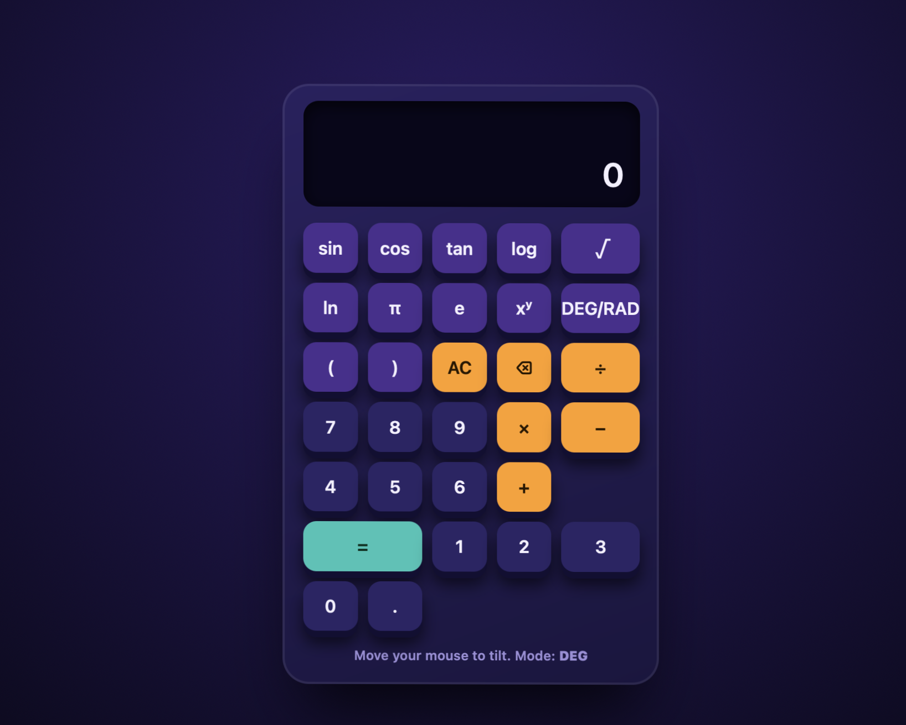
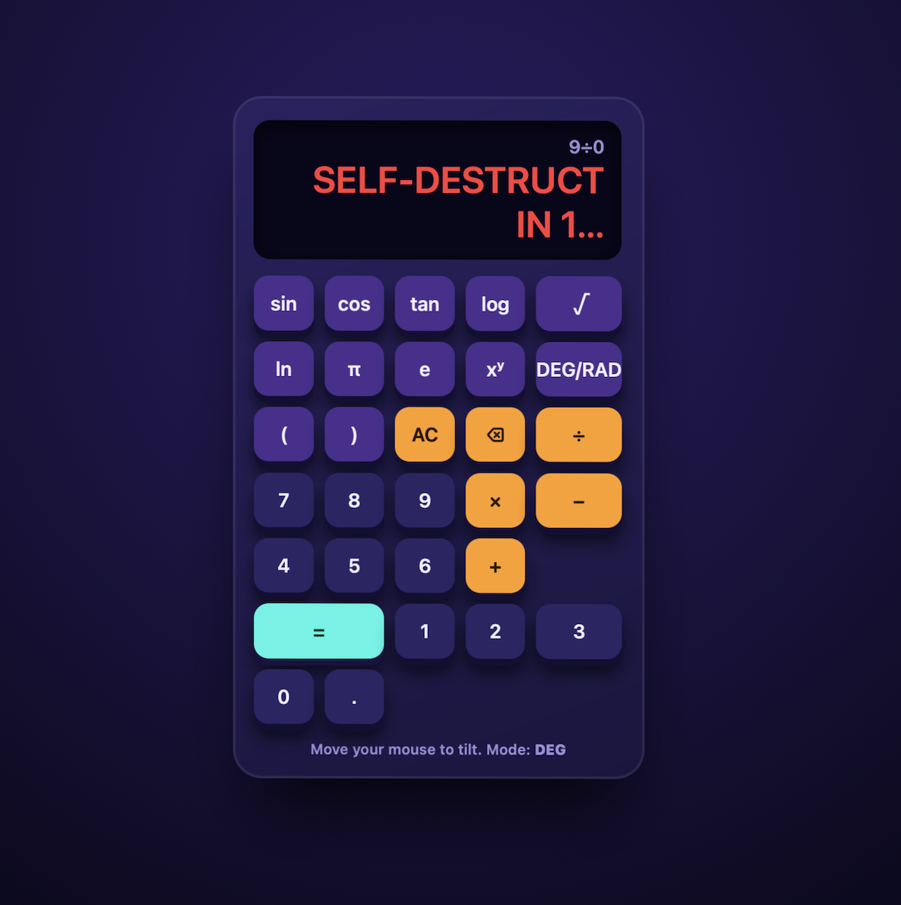
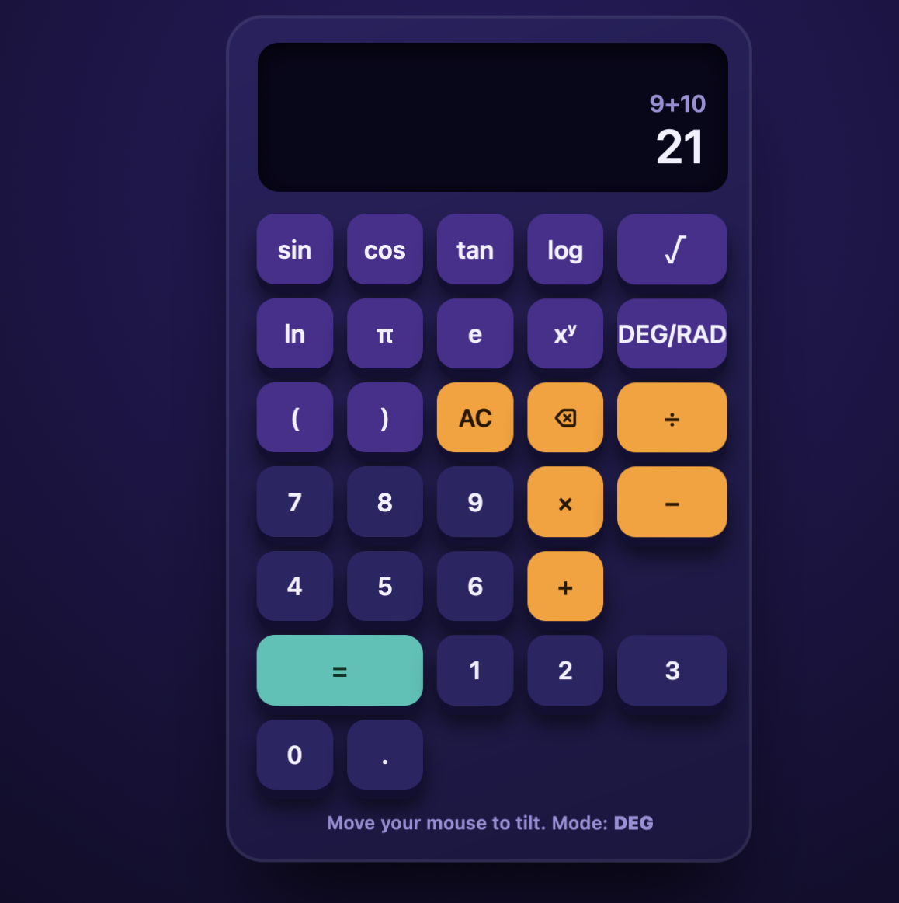

 # The Over-Engineered 3D Scientific Calculator

**Author:** Tausif Raza

A floating 3D scientific calculator built with plain HTML, CSS and JavaScript (no build step, no dependencies).

## How to run

Open `index.html` in a browser. Move the mouse to tilt the calculator. Keyboard input works too (digits, `+ - * / ^ ( )`, Enter, Backspace, Esc).

## Requirements checklist

| Requirement | How it is done |
|---|---|
| 3D tilt/depth effect | CSS `perspective` on the scene, `rotateX/rotateY` on the calculator driven by mouse position, `transform-style: preserve-3d`, and `translateZ` to lift the screen and buttons |
| Scientific functions | `sin`, `cos`, `tan`, `log` (base 10), `ln`, `√`, `xʸ`, `π`, `e`, brackets, DEG/RAD toggle |
| Sarcastic error handler | Each error type (divide by zero, negative square root, log of 0, tan 90°, overflow, bad syntax) has its own sarcastic message |
| Divide by zero | Triggers a 3-2-1 mock self-destruct countdown with screen shake, then shows: "Bro, you just tore a hole in the spacetime continuum. Good job." |
| Animations on every button press | Buttons sink in 3D on press (`:active`) and a `pop` class gives the same animation for keyboard presses |
| `9 + 10 = 21` metric | Handled as a deliberate joke special case before normal evaluation (see below) |

## Approach and algorithm

**Evaluator.** I did not use `eval()`. The expression string is tokenised with a regular expression, then parsed by a small recursive-descent parser. Each grammar level handles one precedence level:

1. `expr`: `+` and `-`
2. `term`: `*` and `/` (throws a divide-by-zero error if the divisor is 0)
3. `pow`: `^` (right-associative)
4. `unary`: leading `-` or `+`
5. `atom`: numbers, constants, brackets and functions

Functions take degrees or radians depending on the mode. Invalid inputs throw a `CalcError` with a kind (`div0`, `sqrt`, `log`, `tan`, `overflow`, `syntax`), and the UI maps each kind to its sarcastic message.

**The 9 + 10 = 21 joke.** The task's humorous metric asks for `9 + 10` to give `21` (the well-known meme). I added one explicit check: if the expression is exactly `9+10`, the result is `21`. Every other calculation is computed correctly. This is intentional and documented here so it is not mistaken for a bug.

**3D tilt.** On `pointermove`, the cursor position is converted to rotation angles stored in CSS variables `--rx` and `--ry`. A slow floating animation runs on a separate wrapper so it does not fight the tilt.

## Screenshots

![Calculator tilted]
![Sarcastic error and self-destruct]
![9 + 10 = 21]

## Tools

Built with AI assistance (vibe coding), then reviewed and tested by me.
